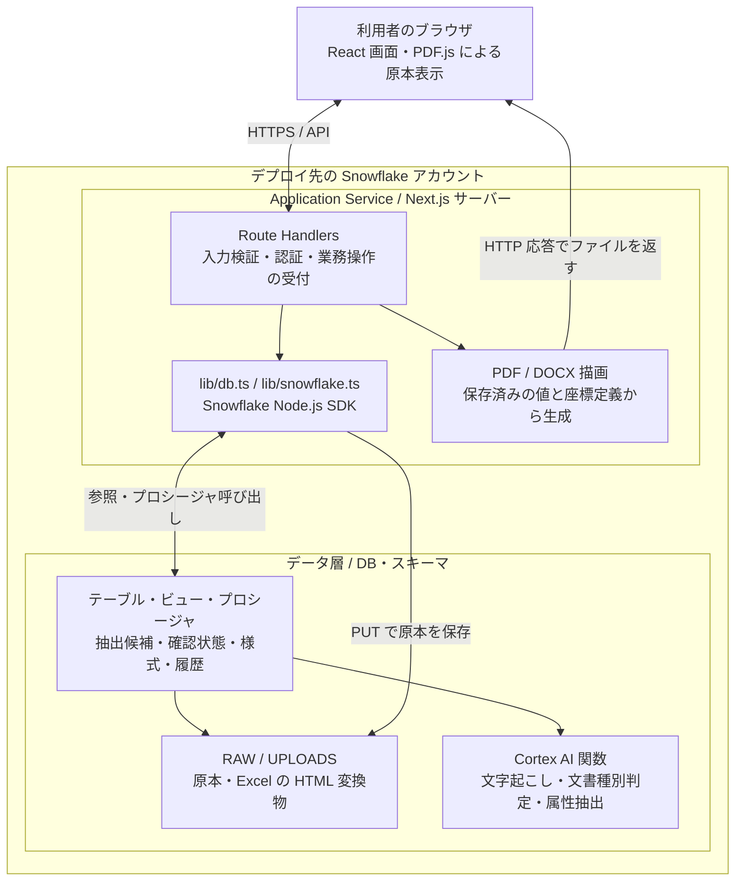
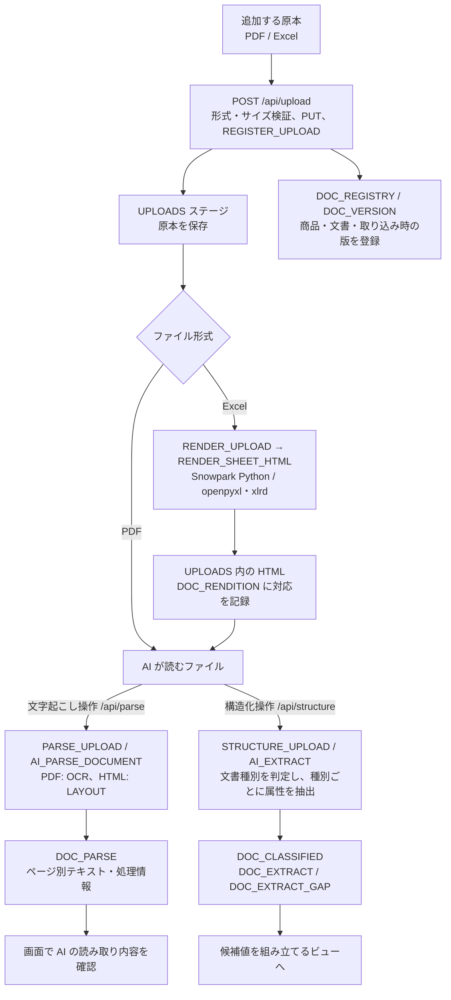
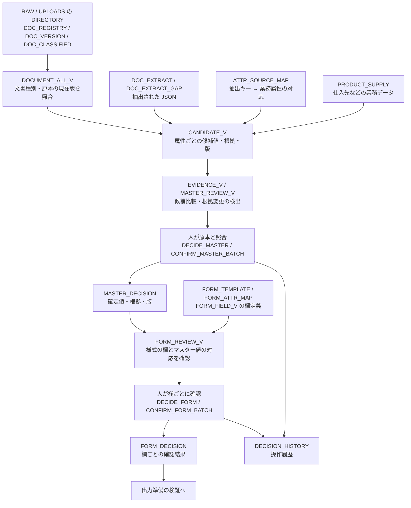
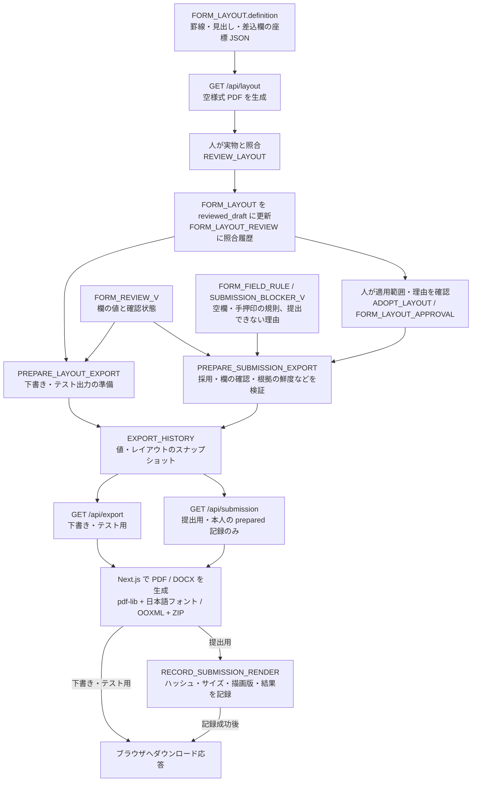

# アーキテクチャ：原本から帳票出力まで

Spec Form Studio は、**AI が原本から候補を抽出し、人が値と様式を確認した後に帳票を作る**アプリです。
Snowflake が原本・抽出結果・確認状態・履歴を保持し、Next.js が画面・API・PDF/Word の生成を担当します。
この文書の図は、リポジトリに同梱した実装を表します。将来構想の構成図ではありません。

- まず全体をつかむ: [README の全体図](README.md#アーキテクチャの全体像)
- 接続・構築: [DEPLOY.md](DEPLOY.md)
- 帳票の描画方式・制限: [EXPORT.md](EXPORT.md)

## 1. 配置と責務

デプロイ済み環境では Next.js サーバーを Snowflake App Runtime の Application Service として動かします。
画面は利用者のブラウザで動きます。下図の矢印は要求と応答の境界を表します。

### 実行権限の境界

- デプロイ済みアプリの DB 呼び出しは、サービス用トークンと利用者トークンを使う caller's rights 接続です。
- **その接続から呼ぶプロシージャの実行権限は別です。** `PARSE_UPLOAD` と `STRUCTURE_UPLOAD` は `EXECUTE AS OWNER` です。AI 処理が読む原本と書く抽出結果は、これらの所有者ロールの権限で処理します。呼び出しにはプロシージャの利用権限が必要です。
- 登録、Excel 変換、確認・採用、出力準備・記録のプロシージャは `EXECUTE AS CALLER` です。`RESTRUCTURE_UPLOAD` も CALLER ですが、内部で OWNER の `STRUCTURE_UPLOAD` を呼びます。
- ローカル開発ではサーバー部分だけを手元で動かし、接続先 Snowflake の実データを読み書きします。ブラウザ利用者ごとの認証ではなく、設定した接続ユーザーの資格情報を使います。

## 2. データ取り込みと AI 処理

**画面操作で開始するオンデマンド処理**です。同梱 SQL は、この流れを自動実行する Snowpipe、Stream、Task、Dynamic Table を作成しません。
アップロードしただけでは AI による文字起こし・属性抽出は始まりません。

**文字起こしと構造化は別経路です。** `DOC_PARSE` のテキストを `AI_EXTRACT` に渡す直列パイプラインではありません。
両方とも原本 PDF または Excel の HTML 変換物を読みます。文書種別判定にも `AI_EXTRACT` を使用し、`AI_CLASSIFY` は使用していません。

- PDF/Excel は 1 ファイルずつ、最大 20 MB。拡張子とファイルシグネチャを検査します。
- Excel の HTML 変換はアップロード後に実行します。変換に失敗しても、登録済みの原本は保持します。
- 文字起こしは保存済み結果があれば再利用します。構造化の再実行は `RESTRUCTURE_UPLOAD` の別操作で、前回結果の破棄と既存確認への影響について同意が必要です。
- 各処理の成功は、値の正しさや正式な確認完了を意味しません。次のレビュー工程が必要です。

### 初期サンプルは別の入り口

`scripts/setup.sh` はサンプル PDF を `RAW` に PUT し、`setup/03-sample-data.sql` で
架空の抽出済みデータ・商品・様式・座標定義などを投入します。**サンプル投入時に AI を実行して抽出するわけではありません。**
初期データも追加アップロードも、後段の候補・レビュー・出力の仕組みを使います。
アプリの追加アップロード先は `UPLOADS` で、既存原本を置く `RAW` には書き込みません。

## 3. 抽出候補から、人が確認した値へ

以下は主なデータ依存と確認操作を示します。矢印の先が自動的に「確定」することを意味しません。

- 文書由来の候補は入力原本 (`doc_role='input'`) で、取り込み時の MD5・更新日時と現在のステージ情報が一致するものを使います。出力用の様式を、そのまま入力原本の候補にはしません。
- `CANDIDATE_V` は `DOCUMENT_ALL_V` を参照するため、試験用アップロードも含み得ます。一方、`DOCUMENT_V` は `upload_purpose='production'` に限定します。試験用アップロードが全レビュー経路から完全隔離される構成とは説明できません。
- AI の抽出結果は候補です。マスターの確認と様式の欄の確認は、別々の操作・別々の記録です。
- 根拠の集合、マスターの版、様式の欄定義、原本の版が変わると、ビューが署名・版の不一致から `changed`（要再確認）を判定します。定期ジョブが確認済みレコードを一括削除する方式ではありません。

## 4. 帳票定義と出力の流れ

値の確認とは別に、帳票の座標 JSON を用意します。任意の様式ファイルをアップロードするだけで、この定義が自動作成される機能ではありません。

提出用では、条件未達なら準備を拒否します。描画例外時は `failed` の記録を試み、成功時は `rendered` を記録してからファイルを返します。
PDF と Word の両方を作る場合は、それぞれ別の出力記録を用意します。

出力時に AI は呼びません。**生成するのは保存済みの値とレイアウトから再構成した文書**です。
PDF と Word の表示差、欄の収まり検証、準備後の変更に関する限界は [EXPORT.md](EXPORT.md) を参照してください。
生成ファイル本体はステージへ自動保存しません。DB に保存するのはスナップショットと履歴で、ファイル本体は HTTP 応答で渡します。

## 5. 実装を読む順序

| 確認したいこと | 主なファイル・識別子 |
|---|---|
| 構築と配置 | [scripts/setup.sh](scripts/setup.sh)、[DEPLOY.md](DEPLOY.md) |
| 接続・認証・DB 呼び出し | [lib/db.ts](lib/db.ts)、[lib/snowflake.ts](lib/snowflake.ts) |
| 原本の登録と Excel 変換呼び出し | [app/api/upload/route.ts](app/api/upload/route.ts) |
| 文字起こし・構造化の受付 | [app/api/parse/route.ts](app/api/parse/route.ts)、[app/api/structure/route.ts](app/api/structure/route.ts) |
| ステージ、テーブル、ビュー、プロシージャ | [setup/02-objects.sql](setup/02-objects.sql) の各識別子を検索。複数回定義されるオブジェクトは最後の定義を参照 |
| 画面へ渡すデータ | [app/api/data/route.ts](app/api/data/route.ts) |
| 人による確認・帳票採用・下書き準備 | [app/api/decision/[operation]/route.ts](app/api/decision/%5Boperation%5D/route.ts) |
| 下書きと提出用の描画 API | [app/api/export/route.ts](app/api/export/route.ts)、[app/api/submission/route.ts](app/api/submission/route.ts) |
| PDF / Word の生成 | [lib/form-layout.ts](lib/form-layout.ts)、[lib/form-layout-docx.ts](lib/form-layout-docx.ts)、[lib/exports-docx.ts](lib/exports-docx.ts) |

Mermaid 対応の Markdown ビューアーでは図として表示できます。図が表示されない場合も、各節の説明とノード名から処理を追える構成にしています。
